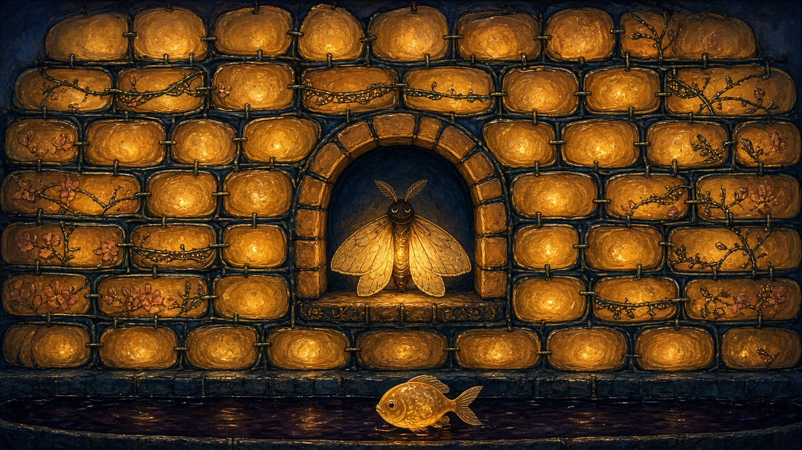

# test-art

A collection of game art assets. Two answers to the same brief: one wall from a 2D indie game, belonging to a world that feels fascinating.

## Gemini — Otherworldly Wall

### Description
A frontal 2D painterly indie game wall asset featuring ancient weathered megaliths engraved with glowing celestial spirals and runes, entwined with bioluminescent creeping vines, glowing spore mushrooms, and embedded amethyst crystal geodes in an atmospheric twilight palette.

## Grok — Duskpear Kiln Wall

### Description
A full-frame frontal set piece from a world where houses are grafted, not built. The courses are kiln-fired slices of amber dusk-pear, still glowing from inside the fruit, mortared with dark wax thread and pinned with oxidized-copper grafting staples. A sleeping paper moth rests in the central alcove, its wings the only lantern. Pressed blossoms run between the bricks, and a glass-bellied fish waits in a channel of orchard syrup along the base. Painterly 2D indie game art, honey amber against ink-blue shadow.
